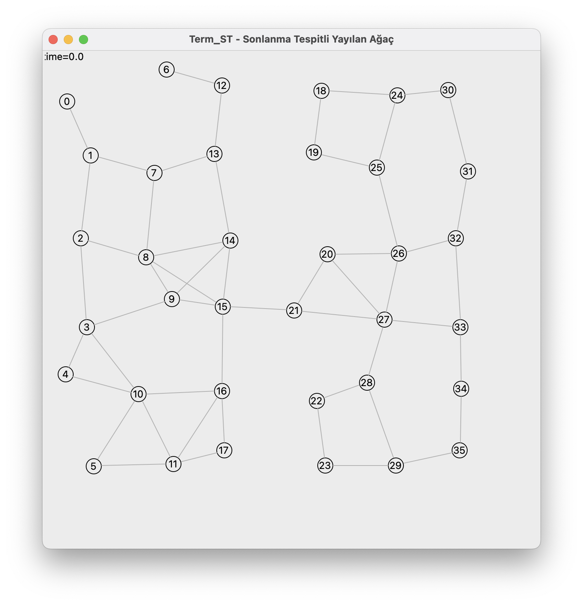
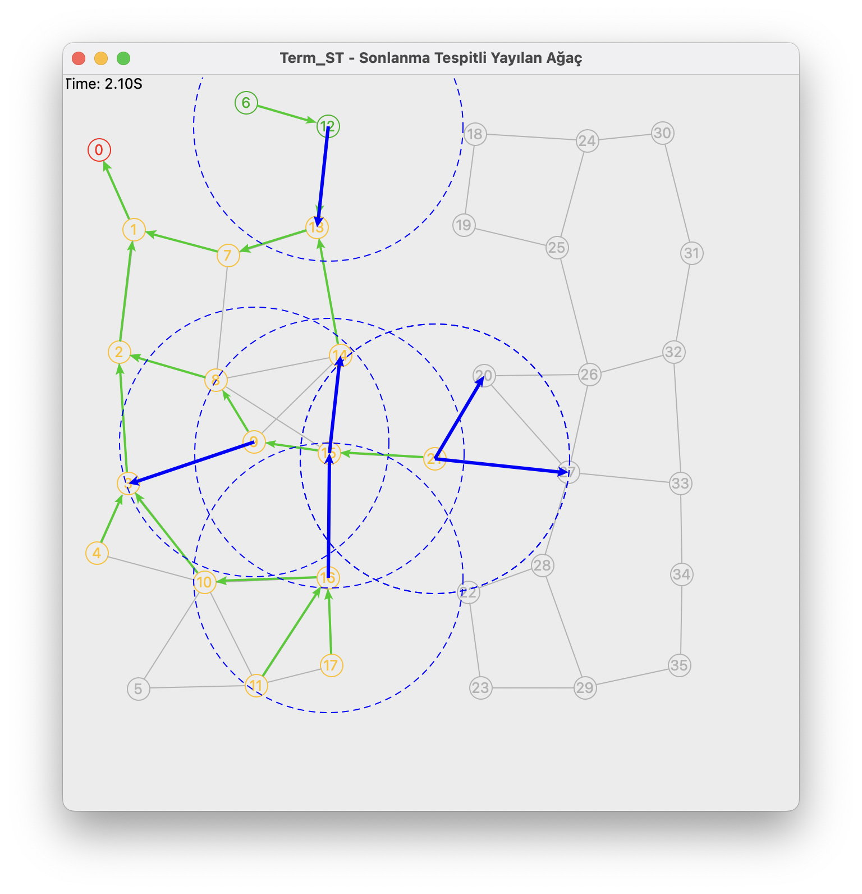
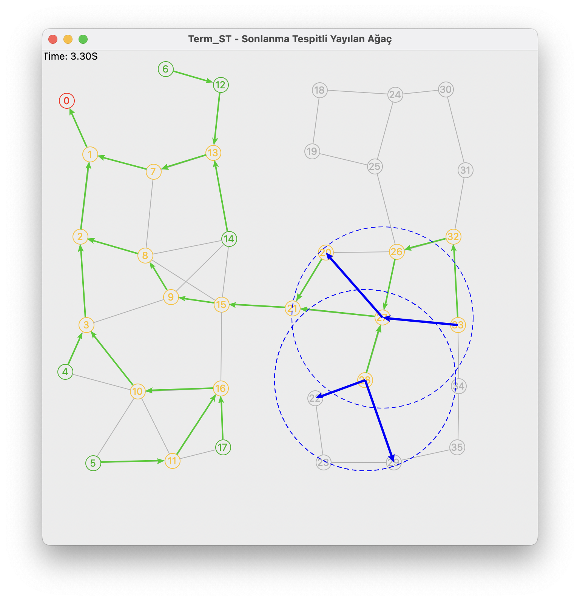
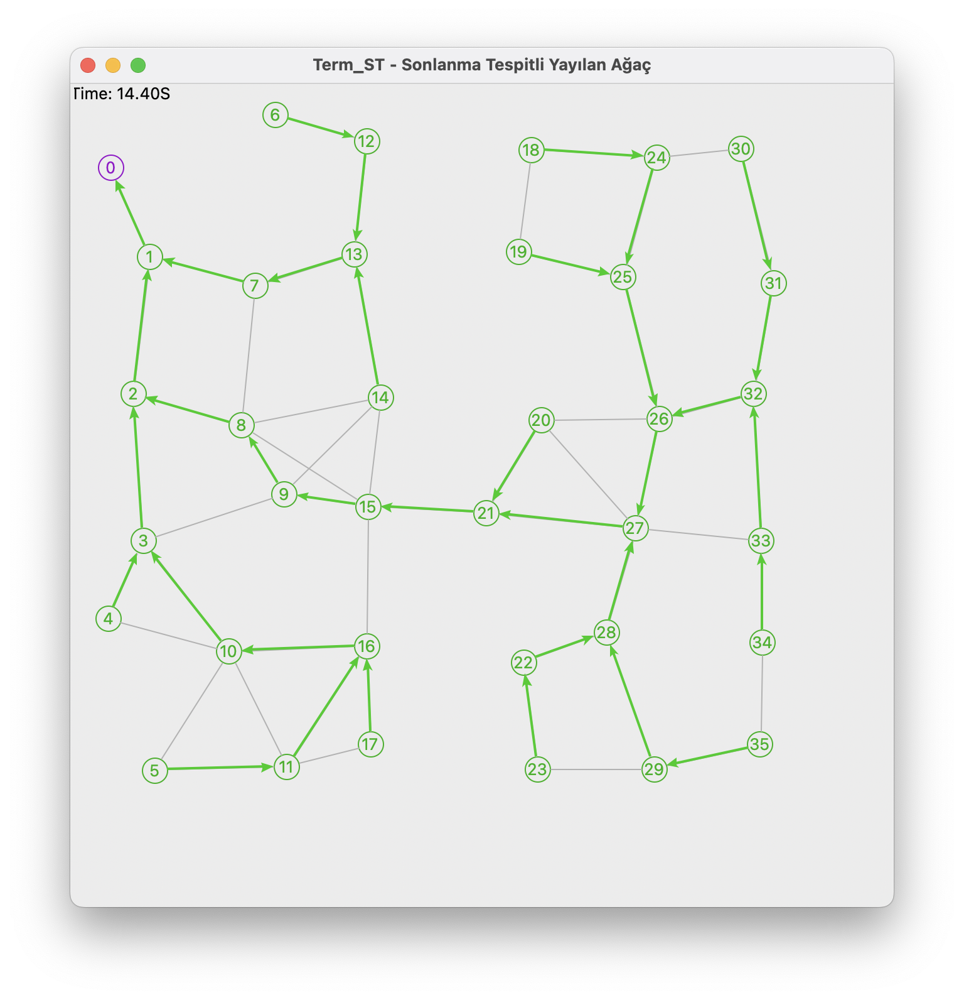

# Sonlanma Tespitli Flooding Tabanlı Spanning Tree Algoritmasının DAWN-Sim ile Simülasyonu

---

## 1. Giriş

Spanning Tree, bir ağdaki tüm node'ları döngü oluşturmadan birbirine bağlayan alt graftır. Dağıtık sistemlerde broadcast, routing ve lider seçimi gibi algoritmaların temelidir.

Flooding tabanlı yaklaşımda root mesaj gönderimini başlatır ve her node ilk mesajı aldığı komşusunu parent seçer. Ama hiçbir node, ağacın **ne zaman tamamlandığını** bilmez. Bu çalışmada **Term_ST** algoritması, yanıtlarla (`ack`, `reject`) bu eksikliği giderir ve root'un **global sonlanmayı** tespit etmesini sağlar.

Amaç, algoritmayı DAWN-Sim üzerinde çalıştırıp davranışını gözlemlemek ve doğruluğunu (sonlanma tespitini) incelemektir.

## 2. Sistem Modeli

- Sistem, birbirinin iletişim menzilinde bulunan node'ların bağlı olduğu bir graftır. Algoritma çalıştığında node'lar arasında kurulan parent-child bağlantıları ise tree edge oluşturur.
- Her node bir kimliğe sahip ve doğrudan olan komşularını (Γ(i)) bilir.
- Haberleşme **asenkrondur**: mesaj gecikmeleri sınırlı ve rastgeledir. Mesajların ulaşma sırası, gönderim sırasıyla aynı olmak zorunda değildir.
- Mesajlar kaybolmaz ve bozulmaz.
- Algoritmayı sadece **root** başlatır.

## 3. Algoritmanın Tanımı

### 3.1 Mesaj Türleri

| Mesaj | Gönderen → Alıcı | Anlamı |
|---|---|---|
| `probe` | node → komşu | "Ağaca katılma daveti (flooding mesajı)" |
| `reject` | node → komşu | "Zaten ağaçtayım, senin çocuğun değilim" |
| `ack` | child → parent | "Benim alt ağacım tamamlandı" |

### 3.2 Değişkenler

| Değişken | Açıklama |
|---|---|
| `currstate` | `IDLE`, `XPLORD`, `TERM` |
| `parent` | Ebeveyn node (başlangıçta tanımsız) |
| `childs` | `ack` gönderen komşular kümesi |
| `others` | `reject` gönderen komşular kümesi |
| `nbrs` = Γ(i) | Komşu kümesi |

### 3.3 Durumlar

```
IDLE --(ilk probe alındı)--> XPLORD --(childs ∪ others = Γ(i) \ {parent})--> TERM
```

- **IDLE:** Node henüz ağaca katılmadı. İlk `probe` mesajında göndereni parent seçer, `XPLORD` durumuna geçer ve parent'ı dışındaki tüm komşulara `probe` iletir.
- **XPLORD:** Node, komşularından yanıt bekler.
  - `probe` gelirse gönderene `reject` döner.
  - `ack` gelirse gönderen `childs` kümesine eklenir.
  - `reject` gelirse gönderen `others` kümesine eklenir.
- **TERM:** Parent dışındaki her komşudan yanıt alındı. Root olmayan node parent'ına `ack` gönderir, root ise algoritmanın global olarak sonlandığını anlar.
  - `TERM` durumundaki node, geç gelen `probe` mesajlarına da `reject` döner.(yanıt bekleyerek sonsuza kadar takılı kalmaması için)
  - Root `IDLE` durumuna girmez; `run()` içinde doğrudan `XPLORD` olur.
  - Parent dışında komşusu olmayan node, `XPLORD`'a geçtiğinde `TERM` olur ve hemen `ack` gönderir.

### 3.4 Sonlanma Koşulu

Bir node i için:

```
childs ∪ others = Γ(i) \ {parent}
```

Koşul sağlandığında node i'nin alt ağacındaki tüm node'lar keşfedilmiş ve sonlanmıştır. Bu bilgi `ack` mesajlarıyla node'lardan root'a doğru yayılır (**convergecast**). Root koşulu sağladığında ise tüm ağın sonlandığını **tespit eder**; node'lar kendi aralarında zaten sonlanmış durumdadır, root bunu öğrenir.

## 4. Uygulama

### 4.1 Dosya Yapısı

```
flooding-spanning-tree-alg/
├── term_st_vis.py     # algoritma ve simülasyon
├── source/            # DAWN-Sim çekirdeği
├── topovis/           # DAWN-Sim görselleştirme
├── img/               # rapordaki ekran görüntüleri
└── REPORT.md
```

### 4.2 Topoloji Üretimi

`create_network()` fonksiyonu node'ları `6 × 6` düzenli bir ızgaraya yerleştirir ve 25 birim rastgele sapma ekler. İletişim menzili 120 birim olduğundan, ızgara aralığı (100 birim) ile birlikte her node birkaç komşuya sahip olur.

### 4.3 Görselleştirme

| Renk | Durum |
|---|---|
| Gri | `IDLE` – henüz `probe` almadı |
| Kırmızı | Root |
| Turuncu | `XPLORD` – keşif aşamasında |
| Yeşil | `TERM` – alt ağacı tamamlandı |
| Mor | Root, global sonlanmayı tespit etti |

Bir node parent'ını seçtiğinde tree edge `scene.addlink` ile çizilir. Tree edge okları **child → parent** yönündedir. Simülasyon sırasında mavi oklar yoldaki mesajları, mavi kesikli çemberler ise mesajı gönderen node'un iletişim menzilini gösterir.

### 4.4 Çalıştırma

```bash
python term_st_vis.py
```

| Parametre | Açıklama | Değer |
|---|---|---|
| `ROOT` | Root id | 0 |
| `TX_RANGE` | İletişim menzili | 120 |
| `SPACING` | Izgara noktaları arası mesafe | 100 |
| `JITTER` | Rastgele sapma | 25 |
| Izgara | Kenar uzunluğu (n = 6² = 36) | 6 × 6 |
| Rastgelelik | `random.Random(1)` | sabit tohum |
| `duration` | Simülasyon süresi | 100 |

## 5. Analiz

n node sayısını, m kenar sayısını gösterir:

### 5.1 Mesaj Karmaşıklığı

Kenarlar ikiye ayrılır:

- **Tree edge (n − 1 adet):** Parent child'ına bir `probe`, child parent'ına bir `ack` gönderir. Child, parent'ına `probe` göndermez. Toplam **2** mesaj.
- **Non-tree edge (m − n + 1 adet):** İkisi de birbirine `probe` gönderir ve her `probe`, `reject` döner. Toplam **4** mesaj.

Toplam mesaj sayısı:

```
2(n − 1) + 4(m − n + 1) = 4m − 2n + 2
```

Bu değer O(m) ve üst sınırı 4m'dir.

### 5.2 Zaman Karmaşıklığı

Her mesajın gecikmesi en fazla 1 zaman birimi olursa `probe` mesajı ağacın derinliği kadar ilerler, sonra `ack`'ler node'lardan root'a geri döner. Asenkron durumda ağaç derinliği en kötü durumda n − 1 olabileceğinden zaman karmaşıklığı **O(n)**'dir.

### 5.3 Doğruluk

**Doğru Sonlanma:** Root, sadece tüm komşularından `ack` veya `reject` aldığında sonlanmayı tespit eder. Bir node sadece kendi komşularından cevap aldıktan sonra `ack` gönderdiğinden root'un sonlanmayı tespit etmesi tüm alt ağaçların tamamlandığı anlamına gelir.

**İlerleyiş:** Graf bağlantılı olduğundan her node en az bir `probe` alır. Her `probe` bir yanıt (child olma veya `reject`) döner ve mesajlar kaybolmadığından her node bir süre sonra `TERM` durumuna ulaşır.

**Ağaç özelliği:** Her node parent'ını sadece bir kez seçtiğinden n − 1 parent kenarı oluşur. Parent seçimi sadece ağaca katılmamış node'lar arasında olur ve döngü oluşmaz.

## 6. Gözlemler

Bölüm 4.4'teki parametrelerle yapılmıştır: 36 node, 53 kenar, root = 0. Mesaj gecikmeleri rastgele olduğundan başka bir çalıştırmada süreler ve ağaç değişebilir ama topoloji aynı kalır.

### 6.1 Başlangıç Topolojisi



*Şekil 1: t = 0.0 anında ağ topolojisi.*

Root (0) yalnızca bir komşuya (1) sahiptir. Ağ iki bölgeden oluşur ve bu bölgeler tek bir kenarla (15–21) birbirine bağlıdır.

### 6.2 Keşif Aşaması



*Şekil 2: t = 2.10. Mavi oklar yoldaki mesajlardır.*



*Şekil 3: t = 3.30. Sağ bölgede keşif sürerken sol bölgenin yaprakları tamamlanmıştır.*

`probe` mesajları root'tan başlayarak ağa yayılır ve her node ilk `probe`'u aldığı komşusunu parent seçer.

### 6.3 Sonlanma Tespiti



*Şekil 4: Son durum. Tüm node'lar yeşil, root mor.*

`ack` mesajları yapraklardan root'a doğru ilerler.

Node 1, t = 10.706'da root'a son `ack`'i gönderir ve t = 11.530'da sonlanır:

```
Node #0  [  11.52973] *** ROOT: ALGORİTMA GLOBAL OLARAK SONLANDI (termination detected) ***
```

### 6.4 Mesaj Sayısı

| | Kuram | Gözlem |
|---|---|---|
| Toplam mesaj | 4m − 2n + 2 = 142 | 142 |
| Tree edge | n − 1 = 35 | 35 |
| Non-tree edge | m − n + 1 = 18 | 18 |
| Root'un tespit zamanı | O(n) | t = 11.53 |

### 6.5 Asenkronluğun Etkisi

Mesaj gecikmeleri rastgele olduğu için oluşan ağaç en kısa yollu (BFS) ağaç değildir. Ağaç derinliği 11 çıkmış, BFS ağacı olsaydı 10 olurdu.

Bir de iki node'un `probe`'ları denk geldiğinde `TERM` olmuş bir node'a geç `probe` gelebilir. Node 18 bu durumda 19'un geç gelen `probe`'una da `reject` döndü:

```
Node #18 [   4.93109] alt ağaç tamamlandı, ack(18) -> parent 24
Node #18 [   5.14872] probe(19) daha önce alındı -> reject
```

## 7. Sonuç

Term_ST algoritması, flooding tabanlı ağaç oluşturmaya `ack` ve `reject` mesajlarını ekleyerek root'un algoritmanın bittiğini anlamasını sağlamıştır. Simülasyonda root sonlanmayı t = 11.53'te tespit etmiş ve o anda diğer tüm node'lar `TERM` durumunda olmuştur. Asenkron gecikmeler yüzünden ağaç en kısa yollu olmadı ama bu algoritmanın doğruluğunu etkilememiştir.

## Kaynaklar

- Dağıtık Sistemler ders notlarım
- https://github.com/mustafatosun/DAWN-Sim